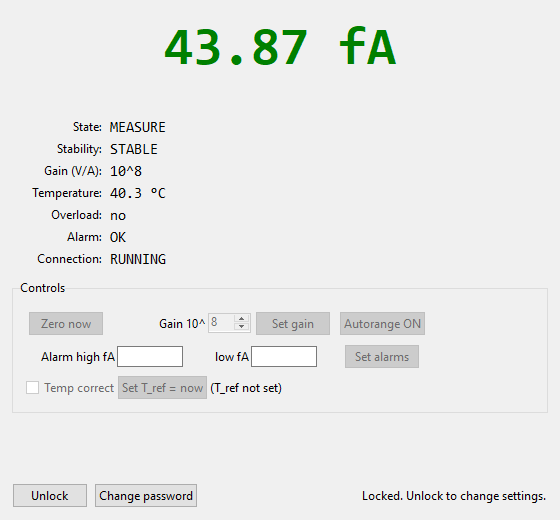

# Picoammeter Readout

A desktop operator panel for a picoammeter (a low-current measurement setup with
a transimpedance amplifier), built in Python with tkinter. It shows a large live
current readout and the instrument's state, with controls for zeroing, gain,
autorange, alarm levels, and temperature correction, all behind a password gate.

This build starts a software simulator in the background, so it works with no
hardware attached. Launch it and the readout comes alive, cycling through warmup,
settle, zero, and measure.

> This is a simulated stand-in for professional work I can't share publicly. It
> reuses the same operator panel and the same file-based frontend/backend split,
> wired to a simulator instead of the real instrument.



## Features

- Large current readout, auto-scaled from fA up to mA, colored green/red/gray by alarm state.
- State, stability, gain, temperature, overload, alarm, and connection fields.
- Zero, set gain, autorange, and high/low alarm levels.
- Optional temperature correction against a reference temperature.
- A password gate on every settings change.
- Alarms are evaluated in the frontend too, so they still work if the backend goes stale.

## How it's put together

```
picoammeter_readout.py   tkinter frontend: readout, controls, polling
simulator.py             simulated backend: writes status, consumes commands
runtime/                 status.txt / command.txt exchanged between the two
```

The frontend never talks to hardware directly. It reads `runtime/status.txt` and
writes `runtime/command.txt`, so it keeps running (showing STALE) if the backend
is down. Swapping the simulator for a real device backend that writes the same
status file would drive the real instrument with no change to the frontend.

## Run it

Python 3 with tkinter (included in standard Python installs):

```bash
python picoammeter_readout.py
```

The simulator starts automatically in the background. Click Unlock (default
password `admin`) to change settings.

## Tech

Python · tkinter · file-based IPC · timer-driven live readout.
